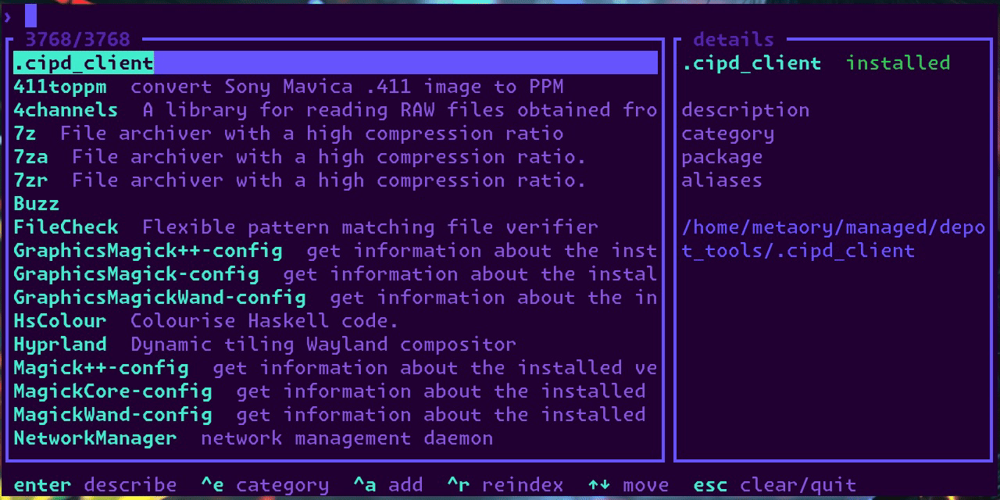

<div align="center">
    
    <h2>treg</h2>
    <h3>
        Find the tool you installed and what it does
    </h3>
    <p>
        fuzzy-matches name, description, or category.
        <br>
        Descriptions come from man pages, a local tldr cache, `.desktop` files, pacman.
        <br>
        Your edits in `~/.config/treg/tools.toml` survive every re-index.
    </p>
</div>

<p align="center">
    
</p>

You have tons of tools installed many with weird names that you forget it next week

## Installation

### Prebuilt binaries

Grab an archive from [Releases](https://github.com/metaory/treg/releases/latest)

| Platform     | Target                                                                                                                        |
| ------------ | ----------------------------------------------------------------------------------------------------------------------------- |
| Linux x86_64 | [x86_64-unknown-linux-musl](https://github.com/metaory/treg/releases/latest/download/treg-x86_64-unknown-linux-musl.tar.gz)   |
| Linux arm64  | [aarch64-unknown-linux-musl](https://github.com/metaory/treg/releases/latest/download/treg-aarch64-unknown-linux-musl.tar.gz) |
| macOS Intel  | [x86_64-apple-darwin](https://github.com/metaory/treg/releases/latest/download/treg-x86_64-apple-darwin.tar.gz)               |
| macOS Apple  | [aarch64-apple-darwin](https://github.com/metaory/treg/releases/latest/download/treg-aarch64-apple-darwin.tar.gz)             |
| Windows      | [x86_64-pc-windows-msvc](https://github.com/metaory/treg/releases/latest/download/treg-x86_64-pc-windows-msvc.zip)            |

```sh
target=x86_64-unknown-linux-musl
curl -fsSL "https://github.com/metaory/treg/releases/latest/download/treg-$target.tar.gz" \
  | tar xz -C ~/.local/bin treg
```

Windows archives are `.zip`

### From source

Requires a Rust toolchain (edition 2024)

```sh
cargo install --git https://github.com/metaory/treg
```

## Usage

```
treg                                        # open the TUI
treg index                                  # re-index $PATH
treg list                                   # name, description, category
treg add qbt "torrent client" Network       # add or override a tool
treg prune                                  # drop tools whose binary is gone
```

The index cache is `$XDG_DATA_HOME/treg/index.json` (`~/.local/share/treg/index.json`). Your edits stay in `$XDG_CONFIG_HOME/treg/tools.toml`.

| Key                    | Action                                     |
| ---------------------- | ------------------------------------------ |
| type                   | search                                     |
| `↑` / `↓`, `^p` / `^n` | move                                       |
| `PageUp` / `PageDown`  | jump                                       |
| `Enter`                | edit the description                       |
| `^e`                   | edit the category                          |
| `^a`                   | add a tool                                 |
| `^r`                   | re-index                                   |
| `Esc`                  | clear the query, then quit; cancel an edit |
| `^c`                   | quit                                       |

In an editor, `^u` clears back to the cursor.

## Development

```sh
cargo run                                              # run the TUI
cargo test --locked                                    # unit tests
cargo fmt --check                                      # rustfmt
cargo clippy --locked --all-targets -- -D warnings     # clippy, pedantic included
```

A release is a tag `vX.Y.Z` whose version matches `Cargo.toml`. The workflow checks formatting, clippy and tests, then uploads the five targets above.

## License

[MIT](LICENSE)
